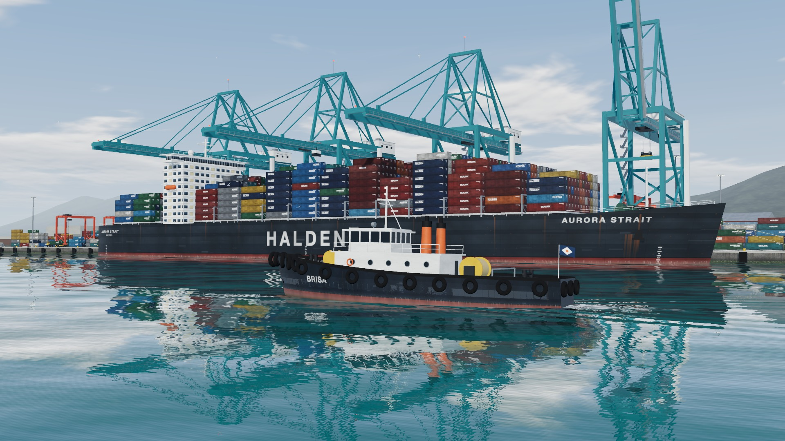
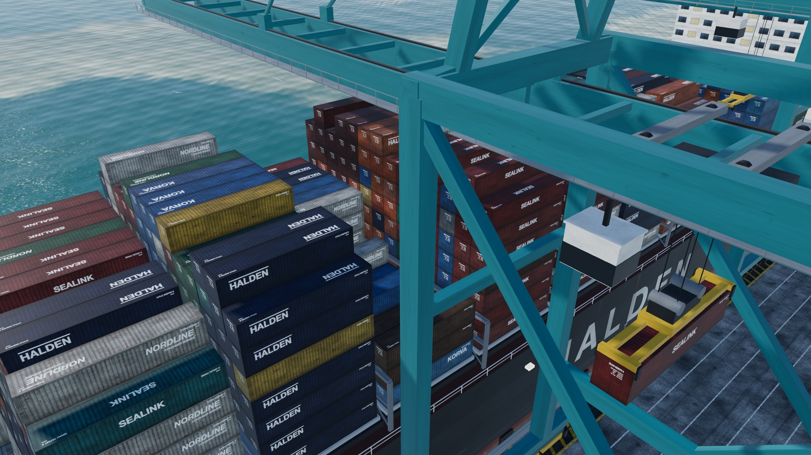
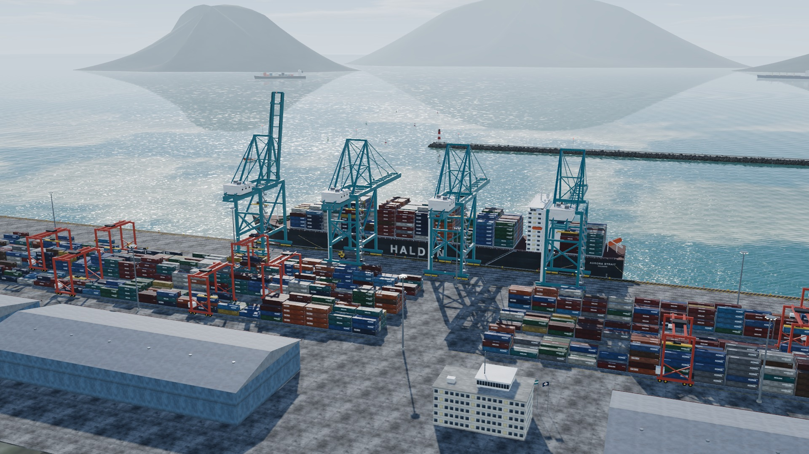
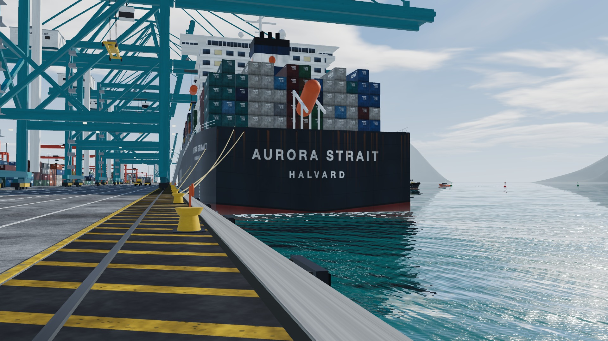
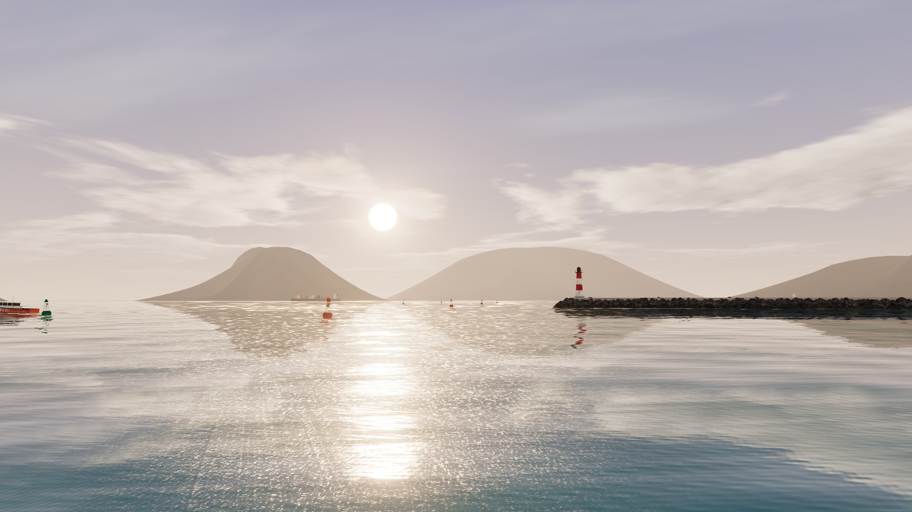

# Port of Halvard

A realistic container sea port that runs in the browser. Every asset is generated in code: the ship,
the cranes, the tug, the water, the sky and every texture. There are no downloaded models and no image
files in this repo.

**Live:** https://moh4696.github.io/sea-port/

> Design study. The port, the shipping line, the ship and the container brands are all invented.



| | |
|---|---|
|  |  |
|  |  |

## What is in the scene

- **MV Aurora Strait:** a 262 m container ship with a lofted hull, painted lettering, rust streaks,
  draft marks, mooring lines and a gangway.
- **Cranes:** four ship-to-shore gantries, one parked with its boom raised. Two of them work: the
  trolley runs out over the ship, the spreader picks a box and lands it on a truck that drives off.
  Rubber-tyred gantries stand over the yard blocks.
- **About 7,500 containers:** one instanced box, each with its own colour, sun-fade, rust and one of
  five invented line logos.
- **Water:** a hand-written shader with travelling-wave normals, a true planar mirror reflection, sun
  sparkle and boat wakes.
- **Sky:** a gradient atmosphere with drifting clouds and a sun. It also lights the scene.
- **Harbour life:** a tug and a pilot boat, bobbing channel buoys, a breakwater with a flashing
  lighthouse, gulls, flags, yard traffic, rotating radar scanners.
- **Ground level:** a quay edge with hazard stripes, fenders and bollards, and a weathered 11 kV
  substation behind a chain-link fence.

## Controls

| Key | Action |
|---|---|
| `1` to `7` | jump to a cinematic shot (they also play in a loop) |
| `F` | free camera: drag to look, scroll to zoom |
| `H` | hide the interface |
| Sun slider | golden hour to midday |

URL options: `?shot=3&hold` stays on one shot, `&sun=9` sets the sun elevation in degrees, `&hud=0`
hides the interface.

## Run it locally

No build step. It needs a local server because it uses ES modules.

```bash
python3 serve.py
```

Then open http://localhost:8985/.

## How it is put together

| File | What it builds |
|---|---|
| `src/main.js` | renderer, lighting, shadows, post-processing, the frame loop |
| `src/tex.js` | every texture, painted on 2D canvases at load |
| `src/sky.js` | sky dome shader and the environment light baked from it |
| `src/water.js` | water shader and the mirror camera |
| `src/ship.js` | hull lofting (shared with the boats), superstructure, cargo |
| `src/containers.js` | the instanced containers and their logos |
| `src/cranes.js` | ship-to-shore cranes, yard gantries, trucks and the discharge loop |
| `src/port.js` | quay, yard, sheds, substation, breakwater, islands, hills |
| `src/boats.js` | tug, pilot boat, buoys, distant ships, gulls, flags |
| `src/shots.js` | the seven camera shots and the free camera |

three.js r169 is vendored in `vendor/three` (MIT).

## Stills and video

Both tools need the local server running and Python Playwright with a Chromium headless shell.

```bash
python3 tools/shoot.py            # captures/shot-N.jpg for every shot
python3 tools/record.py           # video/port-of-halvard.mp4, frame-exact 1080p 60 fps
```

`record.py` renders each frame at an exact scene time, so the clip is smooth however slow the capture
is. The cut list is the `EDIT` table at the top of the file.

## Known limits

- The free camera can pass through objects.
- The inland background is simple blocks in haze.
- Each truck on the crane loop respawns at its start point, which is visible in wide shots.

## License

MIT. See [LICENSE](LICENSE). How it was made is in [PROMPT.md](PROMPT.md).
